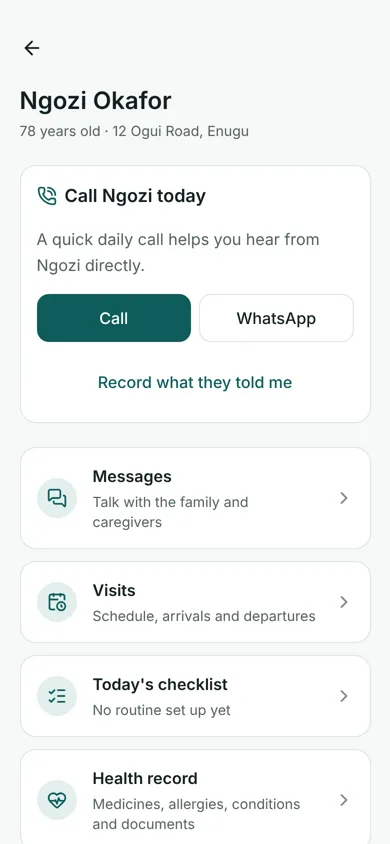
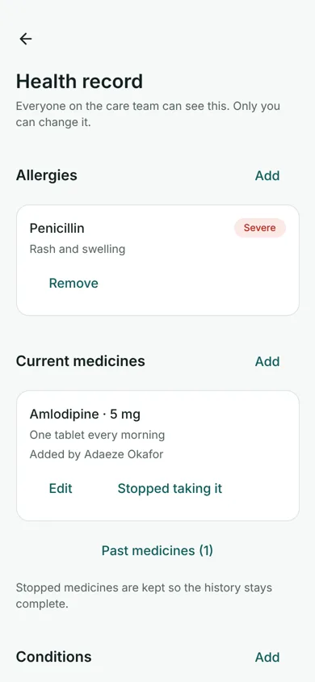
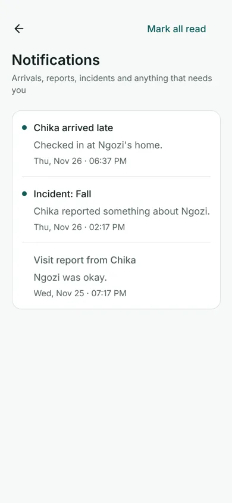
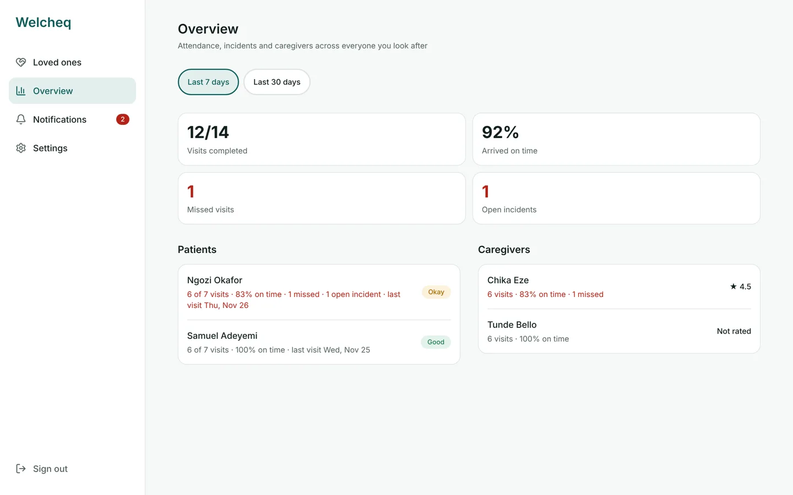
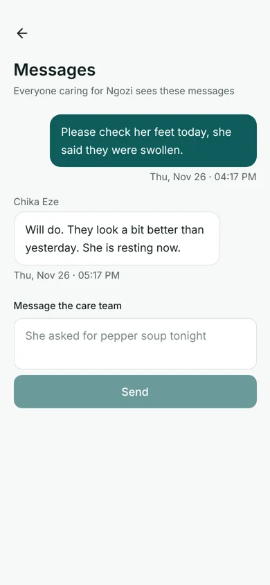
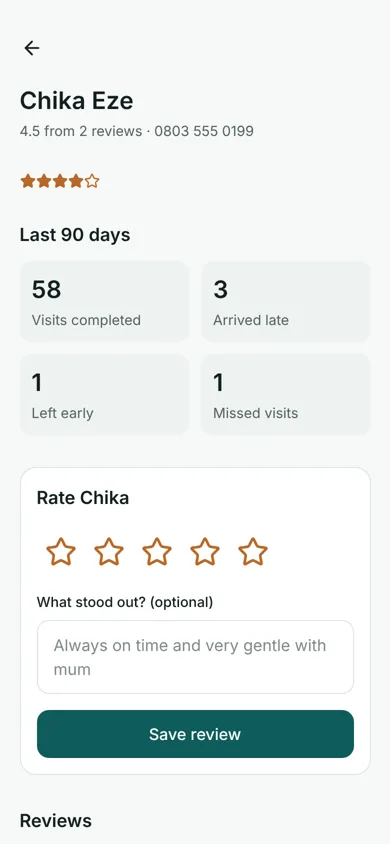
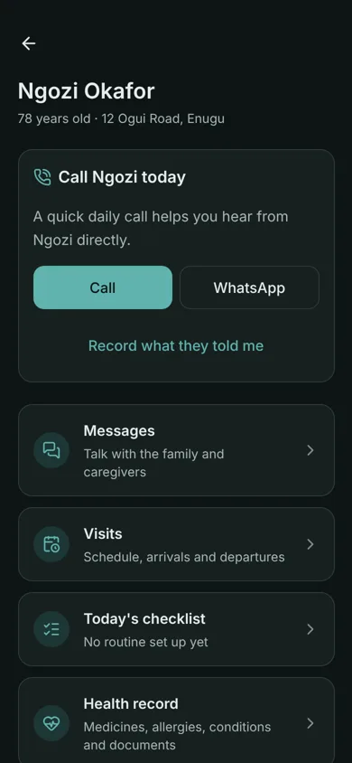

<div align="center">

# Welcheq

**You can't always be there. Now you'll always know.**



&nbsp;

&nbsp;




</div>

## About

Welcheq helps families know whether the care they arrange for a loved one is really happening.
Caregivers check in at the home, follow a daily care plan and record what they did. Families see
every visit from anywhere, and each patient's health details live in one secure record.

## Features

| Feature                       | What it does                                                                                                  |
| ----------------------------- | ------------------------------------------------------------------------------------------------------------- |
| **Verified attendance**       | Check-in only works at the patient's home. Families can add a selfie, rotating home code or surprise check.   |
| **Works offline**             | Check-ins made without signal are kept on the phone and sent when the connection returns.                     |
| **Daily care plan**           | The family sets the routine once; caregivers get it as a daily checklist.                                     |
| **Visit reports**             | After each visit the caregiver records how the patient was, with notes and readings on a number pad.          |
| **Daily call to the patient** | A reminder to call, then a short checklist that flags answers that don't match the caregiver's.               |
| **Health record**             | Medicines, allergies, conditions, readings and document photos, each showing who recorded it.                 |
| **Incidents**                 | Anyone on the care team reports a fall or concern; the family records how it was resolved.                    |
| **Notifications**             | Arrivals, departures, missed visits, reports, incidents and messages, with an unread count.                   |
| **Care team messages**        | One conversation per patient, shared by the family and caregivers.                                            |
| **Reviews and track record**  | Families rate caregivers after a completed visit and see punctuality over the last 90 days.                   |
| **Overview dashboard**        | Visits, on-time arrivals, missed visits and incidents across every patient, for agencies and larger families. |
| **Share with a doctor**       | Exports the health record as FHIR R4 with LOINC-coded vital signs.                                            |
| **Try the demo**              | One tap opens a read-only family or caregiver account filled with two weeks of made-up care history.          |
| **Account control**           | Forgot password by email, and account deletion that removes personal data and sign-in.                        |
| **Display settings**          | Larger text, high contrast, night mode and easier reading for people with dyslexia.                           |
| **One product, three apps**   | Native Android and iOS apps and a full desktop web app on one shared backend.                                 |

<div align="center">

&nbsp;

&nbsp;

</div>

## How it works

1. A family member creates an account and registers their loved one.
2. They set the daily routine and choose how caregivers prove they came.
3. The caregiver checks in at the home and ticks off each task.
4. The family follows every visit and is alerted when something is late, missed or wrong.

## Tech stack

| Layer    | Technology                                                    |
| -------- | ------------------------------------------------------------- |
| App      | Expo, React Native, Expo Router, React Native Web             |
| UI       | NativeWind (Tailwind), Reanimated, Lucide icons, Inter        |
| State    | TanStack Query for server data, Zustand for app state         |
| Auth     | Supabase Auth, tokens kept in the device keystore             |
| API      | Node.js, Express 5, Zod, Pino                                 |
| Database | PostgreSQL (Supabase) with Prisma                             |
| Quality  | Vitest, Supertest, ESLint, Prettier, GitHub Actions, Gitleaks |

## Project structure

```text
welcheq/
  frontend/        Expo app for Android, iOS and web
    src/app/         screens and routes
    src/features/    one folder per feature (auth, patients, attendance...)
    src/components/  shared UI and layout
    src/theme/       design tokens and motion
  backend/         REST API
    prisma/          schema and migrations
    src/modules/     one folder per domain (routes, controller, service, repository)
    src/middleware/  authentication, rate limiting, errors
  shared/          validation schemas, domain constants and logic used by both sides
  docs/            screenshots and the launch checklist
```

## Getting started

**Prerequisites:** Node.js 22+, npm 10+, and a free Supabase project.

```bash
git clone https://github.com/malvisanochie1/Welcheq.git
cd Welcheq
npm install
```

Configure both sides from their examples:

```bash
cp backend/.env.example backend/.env
cp frontend/.env.example frontend/.env
```

Create the database tables, then start the API and the app:

```bash
npm run db:migrate -w backend
npm run dev:api
npm run dev:app
```

Press `a` for Android, `i` for iOS or `w` for web in the Expo terminal.

## Quality checks

```bash
npm run lint
npm run typecheck
npm test
```

Backend tests need a local PostgreSQL database named `welcheq_test`.

## Configuration

**Backend** (`backend/.env`)

| Variable              | Description                                   | Example                          |
| --------------------- | --------------------------------------------- | -------------------------------- |
| `DATABASE_URL`        | Connection used by the running API            | `postgresql://...:5432/postgres` |
| `DIRECT_DATABASE_URL` | Connection used for migrations                | `postgresql://...:5432/postgres` |
| `SUPABASE_URL`        | Supabase project URL, used to verify sign-ins | `https://abc.supabase.co`        |
| `SUPABASE_SECRET_KEY` | Server-only key for private selfie storage    | `sb_secret_...`                  |
| `CORS_ORIGINS`        | Web origins allowed to call the API           | `http://localhost:8081`          |
| `PORT`                | Port the API listens on                       | `4000`                           |

**App** (`frontend/.env`, public values only)

| Variable                               | Description                          | Example                   |
| -------------------------------------- | ------------------------------------ | ------------------------- |
| `EXPO_PUBLIC_API_URL`                  | Welcheq API address                  | `http://localhost:4000`   |
| `EXPO_PUBLIC_WEB_URL`                  | Web app address, used in email links | `http://localhost:8081`   |
| `EXPO_PUBLIC_SUPABASE_URL`             | Supabase project URL                 | `https://abc.supabase.co` |
| `EXPO_PUBLIC_SUPABASE_PUBLISHABLE_KEY` | Supabase publishable key             | `sb_publishable_...`      |

## Before launch

Some settings are relaxed while the app is being built. See the [launch checklist](docs/launch-checklist.md) before inviting real families.

## License

Proprietary. All rights reserved.
